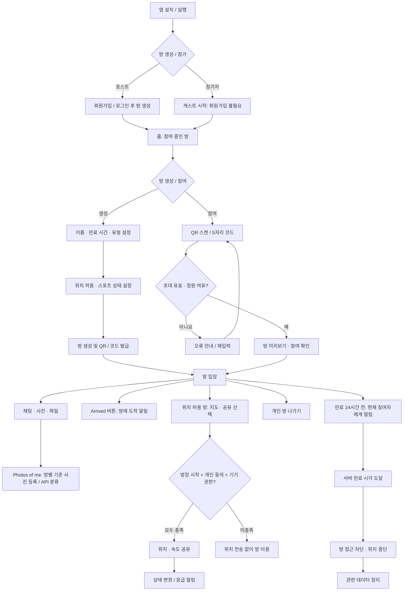
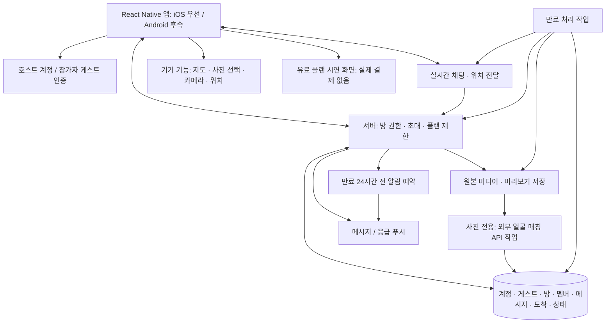

# 일시적 모임을 위한 그룹 채팅 앱 — 기획 초안

작성일: 2026-11-03 (America/Los_Angeles)

최종 요구사항 반영: 2026-11-04. 참가자 게스트 참여, 방별 얼굴 매칭 API, 도착 버튼 우선, 기본 위치 공유 구현 및 백그라운드 고도화 후속, 결제 시연 범위에 관한 사용자의 결정을 반영했다. 아래 변경은 앱 구현 완료를 뜻하지 않는다. 기존 PDF는 변경 전 화면 예시이므로 요구사항이 다르면 이 문서를 기준으로 한다.

이 문서는 사용자가 설명한 아이디어를 Claude에 전달할 수 있도록 정리한 제품 기획 초안이다. 실제 앱은 구현하지 않았다. 아래의 제안·가정은 확정 요구사항과 구분한다. 화면에서 사용하는 Moment는 가칭이다.

## 2026-11-04 추가 확정: iOS 알림 시연 범위

사용자는 이번 마감에 Apple Developer Program 유료 가입을 하지 않기로 했다. iOS 원격 푸시의 실제 APNs 전송은 완료 조건에서 제외하고 알림 경험은 시연으로 제공한다. 실제 방 이벤트·앱 사용 중 알림·소리/진동·만료 24시간 전 알림 로직·서버 만료/삭제는 유지한다. 지원하고 검증한 환경에서는 로컬 알림을 사용할 수 있으나, 원격 푸시 시연을 실제 백그라운드 전송 성공으로 표시하지 않는다. 아래 표나 본문의 일반 푸시 요구와 충돌하면 이 추가 결정을 우선한다. 익명 로그인은 사용자가 활성화했다고 보고했으며 실제 동작 확인 후 상태를 갱신한다. 얼굴 매칭 API는 AWS Rekognition CompareFaces로 진행하기로 했으며 사용자가 키를 준비 중이다. 사용자 스크린샷 기준 개발용 Confirm email은 OFF로 설정했다. 실제 저장 상태와 게스트 가입 동작은 검증한다. 자세한 전달사항은 `planning/USER_DECISIONS_2026-11-04_NOTIFICATIONS_EN.md`를 참조한다.

## 1. 한 문장 설명

QR 코드나 5자리 코드로 참여하고, 정해진 기간 동안 대화·사진·위치를 공유한 뒤 자동으로 종료되는 모임용 그룹 공간.

호스트 계정은 유지하고 모임별 방에 수명을 부여한다. 참가자는 앱을 설치한 뒤 회원가입 없이 게스트로 참여한다. 스포츠 모임은 도착 버튼을 우선 제공하고 기본 위치 공유·경로·속도·개인 상태를 구현한다. 운동 중 잠금 화면에서의 지속적인 위치 공유 안정화는 후속 개발로 둔다. 기본 언어는 영어이며 React Native로 iOS를 먼저 개발하고 Android를 후속 지원한다.

## 2. 문제와 사용 대상

- 모임마다 연락처를 교환하고 기존 메신저에 사람을 추가해야 하는 번거로움.
- 목적이 끝난 채팅방과 사진이 계속 남는 문제.
- 달리기·등산·바이크·드라이브 모임에서 서로의 위치와 상태를 확인하기 어려운 문제.
- 행사 사진 중 자신이 나온 사진을 찾기 어려운 문제.

사용 대상은 스포츠 동호회, 단기 이벤트 및 일시적 모임, 음식점 대기 모임이다. Waiting은 현재 요구사항상 ‘대기 중 소통하는 방’으로 해석한다. 대기번호·순서 변경·호출·노쇼 처리는 별도 기능이며 아직 요구사항으로 확정하지 않는다.

## 3. 사용자 요구사항

| 기능 | 요구사항 |
|---|---|
| 방 수명 | 방장이 방 생성 시 자동 만료 시간을 설정한다. 예: 4일 뒤. |
| 만료 예고 알림 | 방 만료 24시간 전에 방장과 현재 참여자 전원에게 알림을 보낸다. |
| 참여 | QR 스캔 또는 5자리 비밀 코드 입력으로 입장한다. |
| 계정·게스트 | 호스트용 회원가입, 로그인, 로그아웃, 회원탈퇴, 프로필 설정을 유지한다. 참가자는 앱 설치 후 게스트로 방에 참여하며 회원가입을 강제하지 않는다. 서버에서는 게스트도 식별하고 방 권한을 검증한다. |
| 채팅 | 그룹 메시지, 사진·동영상 및 일반 파일 공유. |
| 위치 | 방장이 방 단위로 허용 여부를 설정한다. 사용자는 개별적으로 거부·중단할 수 있다. |
| 원본 사진 | 가능한 한 원본 파일 품질로 업로드하고 다운로드할 수 있다. |
| 업로더 분류 | 내가 올린 사진과 다른 사람이 올린 사진을 구분한다. |
| 얼굴 매칭 | 방에서 기능을 처음 실행할 때 Take photo / Choose from gallery로 본인 얼굴 기준 사진을 등록하고, 얼굴 매칭 API로 내가 나온 사진을 분류한다. 영상 얼굴 인식은 제외한다. |
| 도착 알림 | 참가자가 도착 버튼을 누르면 해당 방에 도착 사실을 알린다. GPS 자동 도착 판정이나 백그라운드 위치 권한에 의존하지 않는다. |
| 스포츠 경로 | 방장이 지도 옆 펜 버튼으로 경로를 그려 공유한다. |
| 스포츠 시작 | 방장이 활동 시작을 누른 이후 동의한 회원의 위치를 공유한다. |
| 지도 표시 | 회원의 프로필 사진을 위치 표시로 사용하고 각 회원의 속도를 표시한다. |
| 상태 | 방장이 사용자 선택용 상태를 정의한다. 예: 쉬는 중, 포기, 물 필요, 도움 필요. |
| 응급 상태 | Emergency는 기본으로 반드시 포함한다. 방 구성원에게 앱 내 알림을 전달하고 일반 푸시를 시도한다. 시스템 재난 경보 수준의 기능은 요구하지 않는다. |
| 퇴장 | 개인이 방에서 나갈 수 있다. |
| 유료 기능 | 추가 이모지, 더 큰 방 정원, 더 긴 만료 기간이라는 기존 구상을 유지한다. 이번 버전은 플랜·혜택 시연 화면만 구현하고 실제 결제는 연결하지 않는다. 결제 대상·가격·기준 인원·기간은 미정이다. |

## 4. 제안하는 기본 동작

### 방과 활동은 별도 수명을 갖는다

- 제안: ‘4일 뒤’의 기준은 서버에서 방 생성이 완료된 시점이다.
- 활동 종료는 위치 공유만 끝낸다. 방은 원래 만료 시각까지 채팅과 사진 공유에 사용할 수 있다.
- 방 만료 시 메시지·파일·위치 접근과 새 업로드·전송을 서버에서 차단한다.
- 서버 만료 작업이 방 데이터, 원본 파일, 미리보기, 얼굴 기준 사진·분석 데이터·매칭 결과, 임시 위치 데이터 등을 실제로 삭제한다. 단순히 화면에서 숨기는 것으로 완료하지 않는다. 정리 실패 시 재시도하며 완료 여부를 확인한다.
- 앱 내부 캐시는 정리한다. 이미 기기 갤러리에 저장한 파일과 캡처본은 남는다.
- 회원 계정과 기본 프로필은 방의 만료와 별개다. 삭제 완료 시점과 백업 보관 정책은 구현 단계에서 정의해야 한다.
- 제안: 유료 기간 연장은 만료 전의 활성 방에만 적용하고, 삭제된 방을 되살리는 기능은 제공하지 않는다.

### 방 만료 1일 전 알림 (추가 요구사항)

- 방 만료 24시간 전에 방장과 현재 방에 남아 있는 참여자 전원에게 푸시 알림을 전송한다.
- 제안하는 영어 문구: **Room ends in 24 hours** / **Sunset Run disappears tomorrow. Download any photos and files you'd like to keep.**
- 알림을 누르면 해당 방으로 이동한다. 유효한 게스트 세션은 회원가입 없이 복귀하며, 계정 인증이 필요한 경우 인증 후 복귀한다. 어느 경우든 현재 방 참여 권한을 검증한다.
- 제안: 만료 24시간 이내에는 방 안에도 만료 예고 배너와 남은 시간을 표시한다. 푸시를 받지 못해도 방에 들어오면 확인할 수 있다.
- 제안: 이미 24시간 미만이 남은 시점에 새로 참여한 사람에게는 입장 시 예고를 표시한다. 방 자체의 기본 유지 기간은 아직 확정하지 않는다.
- 방장이 만료 시각을 바꾸면 이전 알림 예약을 취소하고 새 시각을 기준으로 다시 예약한다.
- 만료 시각의 각 버전마다 사용자별 전송 기록을 남겨 중복 알림을 방지한다. 퇴장·탈퇴한 사람과 이미 삭제된 방에는 예약된 알림을 보내지 않는다.
- 앱 실행 여부와 관계없이 서버에서 발송을 예약한다. 알림 권한과 통신 상태에 따라 실제 기기 수신 여부는 달라질 수 있다.
- 만료 후 뒤늦게 알림을 누르면 만료 안내 화면을 보여준다.

### 도착 버튼과 위치 공유의 개발 범위

- 이번 운동 흐름의 우선 기능은 참가자가 직접 누르는 Arrived 버튼이다. 누른 사람과 도착 시각을 서버에 기록하고 해당 방에 전달한다. 반복 탭으로 도착 알림이 중복되지 않게 한다.
- 도착 버튼은 GPS나 얼굴 매칭 등록 없이 사용할 수 있다. 버튼을 누르지 않은 사람을 자동으로 사고·조난 상태로 판단하지 않는다.
- 실제 기본 위치 공유도 구현한다. 먼저 앱 사용 중 동의한 참가자의 실제 좌표를 다른 기기에서 확인한다. 경로·기본 속도·상태 기능은 유지한다.
- 화면을 잠그고 주머니에 넣은 채 달리는 동안의 지속적인 백그라운드 공유는 후속 개발·안정화 범위다. 이번 버전에서 검증하지 않은 잠금 상태 동작을 완료했다고 표시하지 않는다.

### 위치 공유 조건

위치를 전송하려면 다음 조건이 모두 참이어야 한다.

1. 방이 활성 상태다.
2. 사용자가 현재 방 구성원이다.
3. 방장이 위치 공유를 허용했다.
4. 사용자가 위치 공유를 선택했다.
5. 기기의 필요한 위치 권한이 허용됐다.
6. 방장이 활동을 시작했고 아직 종료하지 않았다.

조건 하나라도 충족되지 않으면 위치를 전송하지 않는다. 방장도 다른 사람의 위치 공유를 강제로 켤 수 없다. 개인 설정 해제·권한 철회·활동 종료·방 나가기·방 만료·로그아웃 시 전송을 중단한다. 재시작·재참여 시 이전 동의를 그대로 켤지는 별도 정책으로 확정한다.

연결이 끊겼거나 앱 사용 중 위치 갱신이 멈춘 사람은 마지막 업데이트 시각과 ‘위치 오래됨’을 표시한다. 오래된 좌표와 속도를 현재 값처럼 표시하지 않는다. 실제 속도는 기기에서 검증한다. 후속 백그라운드 공유는 배터리·권한·앱 종료 동작을 별도로 검증한다. 초기에는 최신 위치만 보관하고 장기 이동 이력은 저장하지 않는 방식을 제안한다.

### 경로 그리기

지도 위의 펜 입력을 위도·경도 좌표의 순서로 변환해서 저장한다. 다른 회원은 같은 좌표의 선을 본다. 이미지 속 선을 AI로 읽는 방식은 필요하지 않다. 도로·산책로에 선을 자동으로 맞추는 기능과 길 안내는 별도 확장 범위다.

### 사진 공유와 두 종류의 분류

- 원본 파일은 별도로 저장하고, 목록에서는 가벼운 미리보기를 보여준다.
- 사진·동영상·일반 파일의 실제 공유 기능은 유지한다. 동영상은 선택·원본 업로드·재생·다운로드를 구현하고 업로드 진행·실패·재시도를 처리한다. 얼굴 매칭 대상은 사진뿐이다. 자동 영상 편집이나 다중 화질 스트리밍은 현재 요구사항이 아니다.
- 사용자가 ‘Download original’을 누를 때 원본을 저장한다.
- 기기에 이미 압축되어 있는 파일의 화질을 복원한다는 의미는 아니다.
- 사진 선택은 기기의 사진 선택기를 활용하는 방향으로 설계하고, 전체 갤러리 접근은 필요한 경우에만 요청한다. 다운로드 저장 권한과 사진 선택 권한을 구분한다.
- 업로더 필터: All / Mine / Others.
- 얼굴 필터: Photos of me.
- 두 필터를 조합할 수 있다. ‘Others + Photos of me’는 남이 올린 사진 중 내가 나온 사진이다.
- 얼굴 매칭은 사용자가 선택해서 이용하는 실제 구현 기능이다. 기능 자체를 후속 개발로 미루지 않는다. 모델을 직접 학습하는 대신 기성 얼굴 매칭 API를 연결한다. API 제공업체는 구현 시 선택한다.
- 각 방에서 Photos of me를 처음 실행하면 Take photo / Choose from gallery로 얼굴 기준 사진을 등록한다. 기본 프로필 이미지나 다른 방의 얼굴 기준을 자동 재사용하지 않는다.
- 본인 동의와 얼굴 기준 사진 등록 후 이용하며, 등록하지 않아도 앱의 나머지 기능을 쓸 수 있다. 얼굴 기준은 일반 공유 갤러리에 공개하지 않는다.
- 일치 여부는 추정 결과로 표시한다. 오분류 제외, 기능 중단, 얼굴 기준 데이터 제거 동작을 정의한다.
- 동의한 사용자의 얼굴 기준과 방 사진을 비교하고, 동의하지 않은 사람의 신원을 붙이거나 검색하는 기능으로 확장하지 않는다.
- 얼굴 기준 사진·분석 데이터·개인 매칭 결과는 해당 방의 해당 참가자 참여에 연결한다. 방 퇴장, 방 만료, 방 삭제 시 서버에서 제거하고 대기 중인 처리 작업도 무효화한다. 외부 매칭 서비스에 데이터를 보관했다면 그 데이터도 삭제 범위에 포함한다. 퇴장 뒤 늦게 끝난 API 작업이 데이터를 다시 생성하지 않게 한다.
- 사용자가 카메라·갤러리에서 제공한 원래 기기 사진을 지운다는 뜻은 아니다. 공유 갤러리의 일반 사진과 개인 얼굴 기준 데이터도 구분한다. 본인이 올린 공유 사진의 퇴장 시 처리 정책은 별도 미확정 항목으로 유지한다.

### 상태와 Emergency

- 방장이 일반 상태 목록을 추가·수정한다. 사용자는 자기 상태만 선택한다.
- Emergency는 지울 수 없는 기본 상태다.
- 제안: 오작동 방지를 위해 Emergency 선택 후 짧은 확인 단계를 둔다.
- 응급 알림 이벤트를 서버에 기록하고 앱 내 알림과 푸시 전달을 시도한다.
- 앱을 사용 중인 다른 방 구성원에게 눈에 띄는 앱 내 경고와 가능한 소리·진동을 제공한다. 앱이 백그라운드에 있으면 일반 푸시를 사용한다. AMBER Alert나 무음·집중 모드를 강제로 우회하는 특별 경보는 요구사항에 포함하지 않는다.
- 통신·권한·기기 설정 때문에 모든 기기에서 소리·진동이 반드시 울린다고 약속할 수 없다.
- 전달·확인 상태를 구분하는 설계를 권장한다. ‘전송 요청’은 ‘전원이 확인함’을 의미하지 않는다.
- 개인 위치 공유를 껐다면 Emergency도 위치를 자동으로 켜지 않는다.
- 긴급 구조기관에 자동 연락하는 기능은 현재 범위에 없다.

## 5. 사용자 흐름



앱 설치·시작 전후의 QR 초대는 해당 방 참여로 이어지게 한다. 참가자에게 회원가입을 강제하지 않는다. 서버는 게스트 세션 식별자와 방 참여 권한을 확인한 뒤 콘텐츠를 제공한다. 호스트 계정 인증이 필요한 흐름에서는 초대 정보를 유지한 채 인증 후 복귀한다.

## 6. 화면 구조

```text
시작
├─ Continue as guest / Join room
├─ Host: Log in / Sign up
└─ Rooms
   ├─ Create room
   │  ├─ Name / Type / Expiration
   │  ├─ Location permission for room
   │  ├─ Sports statuses
   │  └─ Invite: QR / Code
   ├─ Join
   │  ├─ QR scanner / Code input
   │  └─ Room preview / Confirm join
   ├─ Room
   │  ├─ Chat
   │  ├─ Arrived / Arrival notices
   │  ├─ Map（위치 공유를 허용한 방만）
   │  │  ├─ Route editor（방장）
   │  │  ├─ Start / End activity（방장）
   │  │  ├─ Share my live location（개인）
   │  │  └─ My status / Emergency（스포츠）
   │  ├─ Photos / Shared files
   │  │  ├─ All / Mine / Others
   │  │  └─ Photos of me → Take photo / Choose from gallery（방별 선택 기능）
   │  ├─ Invite / Members / Room settings
   │  └─ Leave room / Expired state
   └─ Profile
      ├─ Name / Profile photo
      ├─ Language: English
      ├─ Plus plan preview（시연용, 실제 결제 없음）
      ├─ Log out
      └─ Delete account
```

영어 UI를 기본으로 하되 문구를 분리해 추후 번역 가능하도록 구성한다. 방 상단에는 남은 시간을 지속적으로 표시한다. 위치 공유를 허용하지 않은 방은 Map 탭을 숨긴다.

## 7. 개념적 시스템 구조

React Native + Expo + TypeScript와 Supabase 우선 검토 방향을 유지한다. 얼굴 매칭 API 제공업체는 아직 확정하지 않았다. 아래는 역할을 구분한 구조다.



- 서버는 모든 요청에서 호스트 계정 또는 게스트 세션, 방 멤버 여부, 만료 여부, 역할을 확인한다. 회원가입 없는 게스트도 무인증 공개 접근으로 구현하지 않는다.
- 방장 권한은 설정·상태 정의·경로 편집·활동 시작/종료에 적용한다.
- 원본 파일도 방 권한과 수명에 맞춰 접근을 제한한다. 영구 공개 링크를 만들지 않는 방향을 제안한다.
- 5자리 숫자 코드는 경우의 수가 100,000개다. 활성 방 사이 중복 방지와 조회 시도 제한, 초대 코드 폐기·재발급 동작이 필요하다. QR에는 별도의 긴 무작위 초대 토큰을 사용할 수 있다.
- 실시간 연결에도 같은 만료·멤버십 조건을 적용한다. 만료 정리 작업이 늦어져도 접근은 서버 만료 시각을 기준으로 차단한다.
- 이번 유료 플랜 화면은 시연용이며 실제 구매·청구·구독 권한 발급을 연결하지 않는다. 실제 결제를 후속 연결할 때 구매 검증과 플랜 제한을 서버에서 적용한다.
- 위치 수집은 허용된 상태에서만 시작한다. 탈퇴·퇴장·만료 후 늦게 도착한 위치 이벤트도 거부한다.

### 핵심 데이터

| 데이터 | 주요 내용 |
|---|---|
| User / GuestSession | 계정 또는 게스트 식별자, 표시 이름, 프로필 이미지, 언어 |
| Room | 방 ID, 방장, 유형, 생성·만료 시각, 위치 허용, 상태 |
| RoomMember | 방·사용자 ID, 역할, 참여·퇴장, 개인 위치 공유 선택 |
| Invite | 방 연결, 코드·토큰 정보, 유효 기간, 폐기 여부 |
| Message | 방·발신자·본문·첨부 참조·시각 |
| Media | 방·업로더·원본·미리보기·종류·크기 |
| Activity | 방·경로 좌표·시작·종료·진행 상태 |
| Arrival | 활동·참가자·도착 시각, 중복 알림 방지 |
| LivePresence | 회원의 최신 좌표·속도·정확도·업데이트 시각 |
| StatusDefinition / MemberStatus | 방별 상태 목록 / 현재 개인 상태 |
| EmergencyEvent | 발신자·시각·전달·확인 상태 |
| ExpiryReminder | 방·사용자·만료 시각 버전·예약 시각·전송 상태 |
| FaceReference / PhotoMatch | 방·참가자 참여에 연결된 본인 얼굴 기준·분석 데이터 / 사진별 추정 일치. 퇴장·방 만료·삭제 시 제거 |
| PlanPreview | 유료 혜택 시연용 정보. 실제 Subscription·구매 검증은 후속 개발 |

위치·얼굴 기준 데이터는 일반 프로필과 별도의 접근·삭제 규칙으로 관리한다. 얼굴 매칭은 비동기로 처리해서 채팅과 사진 업로드를 막지 않는 구조를 제안한다.

## 8. 초기 구현·검증 범위

전체 제품 목표는 유지하되, 첫 실사용 검증은 작은 러닝 크루에 집중하는 방안을 제안한다. 이는 사용자 요청에 이미 포함된 대상 중 하나를 먼저 선택한 것이며 확정 방향은 아니다.

### 첫 MVP

호스트 계정, 참가자 게스트 참여, 방 생성·만료 및 실제 서버 삭제, 만료 24시간 전 알림, QR/코드 참여, 그룹 채팅, 원본 사진·동영상·일반 파일 공유, 업로더 필터, 사진 전용 얼굴 매칭 API, 방 나가기 및 얼굴 데이터 삭제, 도착 버튼과 방 내 알림, 앱 사용 중 동의 기반 실제 위치 공유, 간단한 경로, 기본 속도 표시, 상태와 앱 내 Emergency·일반 푸시, 유료 플랜 시연 화면.

실제 기기와 여러 사용자로 도착 알림·위치·사진 및 영상 공유·얼굴 분류·일반 알림 동작을 확인한다. 방 만료 시 서버 접근 차단과 저장 파일의 실제 삭제를 확인한다. 얼굴 기준 등록 이후 기존 사진과 새로 올라온 사진을 분류하고, 퇴장·방 만료 후 기준 데이터 및 늦게 끝나는 작업이 남지 않는지 확인한다. 유료 플랜 화면은 의도적인 시연 범위임을 명시하고 실제 결제 완료로 표현하지 않는다.

### 후속 검증

잠금 화면·주머니 속 운동 중 지속적인 백그라운드 위치 공유 안정화, Android 기기 지원·검증, 실제 유료 결제, 다양한 이모지 확장, 고급 경로 보정·길 안내, 대규모 영상 처리, 식당 대기 운영 기능. 일반적인 동영상 공유와 사진 얼굴 매칭을 이 목록으로 임의로 미루지 않는다. 얼굴 매칭은 실제 API 결과를 검증하고 화면만으로 구현 완료라고 표현하지 않는다. 영상 속 얼굴 인식은 요구하지 않는다.

### 사용자 데이터로 확인할 항목

- 초대부터 입장까지 걸리는 시간과 실패 원인.
- 기존 단체 채팅 대신 사용할 의향, 다음 모임에서의 재사용.
- 도착 버튼 알림 성공, 위치 공유 동의율과 운동 중 상태 공유의 유용성.
- 원본 사진·동영상 업로드·다운로드 성공, 업로드 시간과 저장 비용.
- 사진 얼굴 매칭의 실제 분류 결과와 퇴장·만료 시 얼굴 데이터 삭제.
- 방 만료·다운로드 보존에 대한 사용자의 이해.
- 배터리·연결 끊김·알림 미수신 사례.

## 9. 개발 전 확정할 정책

1. 무료·유료의 가격, 방 정원, 기간, 업로드 크기·총량.
2. 방장이 나갈 때 다른 회원에게 방장 이전을 필수로 할지, 방 종료를 허용할지.
3. 퇴장·탈퇴 시 본인이 올린 메시지·사진을 언제 제거할지.
4. 만료 24시간 전 알림 문구와 방 안 배너의 세부 동작, 서버 삭제 완료 시점, 백업 정리 기준.
5. 얼굴 매칭 API 제공업체·일치 판정 기준·구현 방식. 기준 사진은 방별 최초 사용 시 등록하고 퇴장·방 만료·삭제 시 제거한다는 요구사항은 확정되어 있다.
6. Waiting을 단순 채팅으로 시작할지, 실제 대기열 관리까지 포함할지.

## 10. Ignite Grant 맥락

사용자가 제공한 안내문 기준으로 제출 마감은 2026-11-09이며, Tangible Accomplishment / Traction이 가장 중요하다고 명시되어 있다. 실제로 작동하는 핵심 흐름과 소규모 사용자 검증 결과를 보여주는 자료가 이 프로젝트의 제출 근거가 된다.

공통 채팅방이 필요했던 모임 하나에서 방 생성 → 게스트 QR 참여 → 채팅·도착/상태 공유 → 원본 미디어 저장·사진 얼굴 분류 → 만료·서버 삭제를 관찰하는 데모를 제안한다. 실제로 아직 구현하지 않은 기능은 미완료로 표시한다. 백그라운드 위치 안정화와 실제 결제는 후속 계획으로 구분한다. 비용 사용 계획은 구체적 개발 과업과 사용자 검증 비용에 연결한다.

## 11. 와이어프레임 범위

홈, 방 생성, 참여, 초대, 채팅, 스포츠 지도, 사진, 계정, 유료 플랜, 만료, 로그인/회원가입 화면을 탐색할 수 있다. 지도는 경로와 마커 배치를 보여주는 개략도이고 속도·위치·사진 분류 결과는 예시다. 프로필 사진 자리에는 이니셜을 사용한다.

이 화면 설계는 실제 앱, 서버, 카메라, GPS, 얼굴 인식, 결제 또는 데이터 삭제를 구현한 결과가 아니다. 실제 사진·영상·파일 뷰어, 멤버 관리, 방 설정 편집, 전체 경로 편집 등 세부 화면은 후속 설계 범위다.

기존 PDF에는 이번에 확정한 게스트 입장·도착 버튼·방별 얼굴 등록·결제 시연 구분이 아직 반영되지 않았다. 구현 시에는 이 문서의 최신 요구사항을 적용하고 PDF의 이전 계정 필수 흐름이나 계정 단위 얼굴 등록을 그대로 옮기지 않는다.
